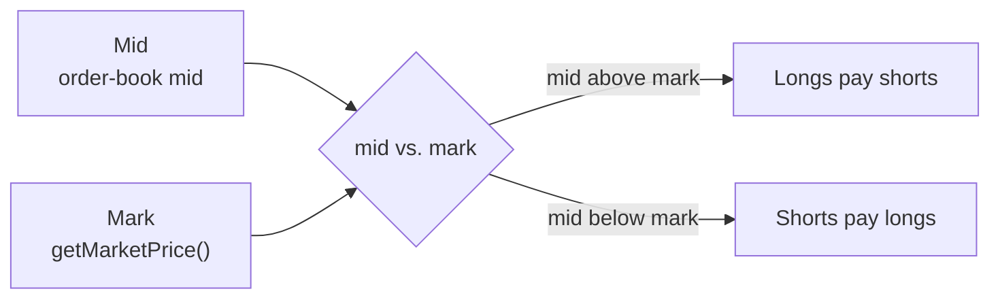

# Positions & Funding

Once your orders fill you hold a **net position**. This page explains how
that position is tracked, how PnL works, how **funding** keeps the
perpetual tethered to its mark, and how the mark glides through a Bitcoin
halving.

Three prices appear below:

| Price  | What it is                                                                      |
| ------ | ------------------------------------------------------------------------------- |
| Index  | The hashprice oracle (`HashpriceUSD`): what one PH/s earns per day at the tip.  |
| Mark   | `getMarketPrice()`: the index, gliding to its post-halving level in the week before a halving. |
| Mid    | The order-book mid, `(best bid + best ask) / 2`.                                |

---

## Net-position accounting

Each account has exactly **one** position per market, not a list of lots:

```solidity
struct Position {
    int256  netQuantity;         // + = long, − = short (QUANTITY_DECIMALS = 6)
    uint256 aggregatedEntryPrice; // weighted-average entry price
}
```

Every fill folds into this single position.

### Adding to a position (same direction)

The entry price becomes the **notional-weighted average** of the old and new
fills:

```
newEntry = (|oldQty|·oldEntry + |fillQty|·fillPrice) / |oldQty + fillQty|
```

Example:

```
Have:  +2 long @ 4.00
Buy:   +1 long @ 4.30

netQuantity        = +3
aggregatedEntry    = (2·4.00 + 1·4.30) / 3 = 4.10
```

### Reducing a position (opposite direction)

Trading against your position realizes PnL on the closed slice at the trade
price; the entry price of the remainder is **unchanged**:

```
Have:  +3 long @ 4.10
Sell:  −1      @ 4.25

Realized PnL = (4.25 − 4.10) × 1 = 0.15
Remaining    = +2 long @ 4.10  (entry unchanged)
```

### Flipping

If an opposite order is **larger** than your position, the position closes
fully (realizing PnL on the old size) and a **new** position opens on the
other side, sized by the excess, at the trade price.

## Unrealized PnL

Marked continuously against the **mark**, plus the drift accrued since the
position was last touched (see [The halving glide](#the-halving-glide-and-drift)):

```
Unrealized PnL = (mark − aggregatedEntryPrice) × netQuantity / 10^QUANTITY_DECIMALS + pending drift
```

Because `netQuantity` is signed, longs profit when price rises and shorts
profit when price falls. Read it with `getUnrealizedPnl(user)`.

> Realized PnL settles against the insurance fund. A winning close is paid
> from the fund; a losing close pays into it. If the fund cannot cover a
> winning close, the vault borrows the rest from the shared collateral pool
> and the winner is still paid in full. If a past loss of yours went unpaid,
> it is recorded as account debt, and later winnings first pay it off.

---

## Funding

A perpetual has no expiry to force its price back to fair value, so a
periodic **funding** payment does it instead. When the order book trades
**above** the mark, longs pay shorts; when it trades **below**, shorts pay
longs. This incentivizes traders to push the book back toward the mark.

### The two prices

| Leg  | Source                                                         |
| ---- | -------------------------------------------------------------- |
| Mid  | Order-book mid — `(getBestBidPrice() + getBestAskPrice()) / 2` |
| Mark | `getMarketPrice()`                                             |

If either side of the book is empty, no new funding accrues.

### The funding rate

```
fundingRate = (mid − mark) / mark        (per funding period)
```

clamped to ±`fundingRateMaxBps` per `fundingPeriod` (both owner-configured).
A positive rate means the book is rich → longs pay shorts.



### How it accrues and settles

- A **global cumulative funding index** (`cumulativeFundingPerUnit`) grows
  over time at the current rate. Anyone can advance it with `updateFunding()`,
  and it is refreshed automatically before every order, cancel, and
  liquidation.
- Each account stores a **snapshot** of that index taken when its position
  was last touched. Your owed/received funding is:

```
funding = netQuantity × (cumulativeIndexNow − yourSnapshot) / (10^QUANTITY_DECIMALS · 10^FUNDING_DECIMALS)
```

- Funding is **settled into your vault balance** (against the insurance
  fund) whenever your position is touched — before any size change so it is
  charged on the old size. Positive = you pay, negative = you receive.
- If you owe funding but can't cover it, the vault records the shortfall as
  bad debt. Funding the fund owes you first pays off any account debt you
  owe; the rest is paid in full, borrowing from the shared pool when the
  fund balance is empty.

### Checking funding

- `getPendingFunding(user)` — unsettled funding accrued so far (positive =
  you owe, negative = you receive).
- The `FundingUpdated` and `FundingSettled` events track the global index and
  per-user settlements.

> **Funding affects your margin.** Owed funding is settled out of your
> balance, moving you closer to your maintenance threshold. Account for it
> when sizing collateral.

---

## The halving glide and drift

Every 210,000 Bitcoin blocks the block subsidy halves, and the index drops by
about half in that one block. The date is known years ahead, so the perps mark
does not wait for it:

- Until 1,152 blocks (about 8 days) before the halving, the mark is the index.
- Over the next 1,008 blocks (about 7 days) it steps down, block by block, to
  the **post-halving price**: the index × (subsidy after the halving + fees) /
  (subsidy + fees), with the fees averaged over the last 144 blocks. That ratio
  is about 50%.
- It reaches that price 144 blocks before the halving and holds there until the
  halving block, when the index itself falls to meet it. Fees, difficulty and
  BTC/USD keep moving the mark as they move the index.

The decline is scheduled, so it is not a loss to anyone: **longs are paid it as
drift** and shorts pay it. At each funding update the position accrues

```
drift per contract = mark × (old factor − new factor) / old factor
```

where the factor is the mark's scheduled share of the index (1 before the
glide, about 0.5 at its end). Holding through the glide is therefore neutral on
either side. Pending drift is part of the position's unrealized PnL
(`getPendingDrift(user)`), not funding owed, so the margin engine sees a held
position as neutral too; it is folded into the entry value whenever the
position is touched.

---

## Position views

| View                      | Returns                                         |
| ------------------------- | ----------------------------------------------- |
| `getUserPosition(user)`   | `{ netQuantity, aggregatedEntryPrice }`         |
| `getUnrealizedPnl(user)`  | Mark-to-market PnL, pending drift included, net of pending funding |
| `getPendingFunding(user)` | Unsettled funding                               |
| `getPendingDrift(user)`   | Drift accrued since the position was last touched (+ = you gain) |

Position-holder lists are maintained off chain from indexed events; the contract
does not expose global participant enumeration.

---

## Read next

- [Margin & Liquidation](./05.Margin-and-Liquidation.md) — staying solvent.
- [Fees](./06.Fees.md) — trading costs.
